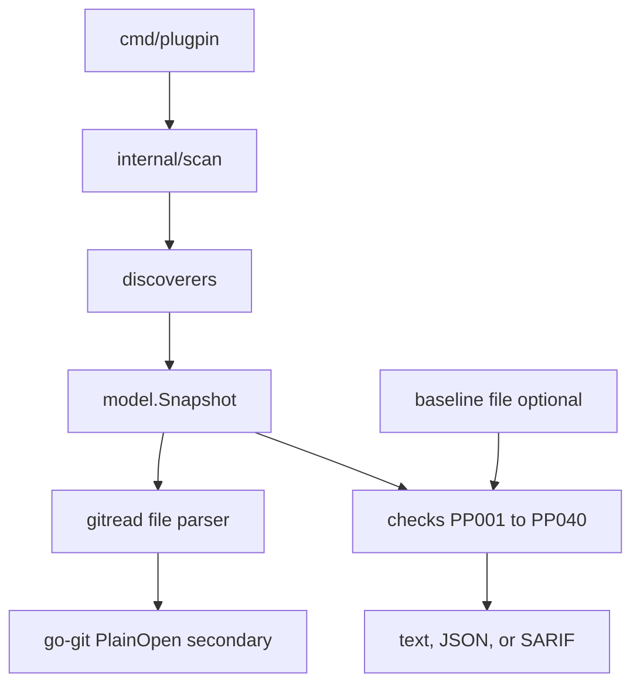

# Architecture

plugpin is one static binary. A scan reads files, builds a snapshot, and
evaluates rules. The default path does not start a process and does not use
the network.

## Packages

| Package | Responsibility |
| --- | --- |
| `internal/discover` | Claude Code, Codex, Copilot CLI, Gemini CLI, and project files |
| `internal/inventory` | Hook documents, MCP documents, hook directories, folderOpen tasks |
| `internal/plugstate` | Attach resolved HEAD, branch names, and a content hash to a plugin |
| `internal/gitread` | Parse `HEAD` and `packed-refs`. File bytes decide whether HEAD is attached |
| `internal/cfgparse` | Hook JSON, MCP JSON, Codex TOML |
| `internal/catalog` | Embedded `data/rules.yaml` and `data/floors.yaml` |
| `internal/checks` | Pure evaluation. Does not touch the disk |
| `internal/baseline` | `plugpin.baseline/v1` read, write, and drift |
| `internal/report` | `plugpin.report/v1`, text, and SARIF 2.1.0 |
| `internal/fsx` | Regular-file reads, symlink refusal, walk caps, tree hash |
| `internal/execx` | The only process boundary. `Disabled` unless `--exec-version` |

go-git opens a repository with `DetectDotGit: false`. It unions branch names
and fills a hash when the file parser already decided attachment. plugpin
never looks up `git` on `PATH`.

## Filesystem limits

`internal/fsx` refuses a symlink as the final component of a config path and
does not follow directory symlinks. Tree hashes skip `.git` and skip symlink
targets that escape the root. Caps are depth 8, 2000 files, 1 MiB per hashed
file, and 2 MiB per config file. Content hashes use slash-separated paths
relative to the hashed root.

## Secrets

Environment variable values and HTTP header values are dropped at parse time.
Reports keep environment key names only. Userinfo is stripped from URLs. MCP
query strings are kept, because they can be part of the server identity; treat
a report as sensitive. `--redact-paths` rewrites the home prefix to `~` and
the project prefix to a relative path, including when those strings are
embedded in warnings.

## Version and exit

`internal/cli.Version` defaults to `0.1.0` and can be overridden with
`-X github.com/alikesk222/plugpin/internal/cli.Version`. Exit 0 means no
finding at or above `--fail-on` (default `medium`, inclusive). Exit 1 means
such a finding exists. Exit 2 means usage or a runtime error.
